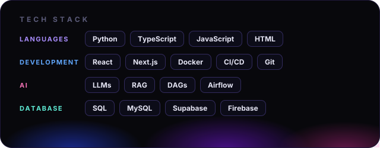

## A Little About Me

Hey! I'm **Mohammed Suhaib S** — a Software Developer from **Bangalore, India**, turning random ideas into software that actually works. 🚀

I love clean code, clever solutions, breaking things (occasionally 😅), and figuring out how to build them better.

* **Currently:** Working as a Software Developer and making ideas come to life.
* **Always curious:** Exploring new technologies, experimenting with tools, and finding smarter ways to build.
* **My vibe:** Build it. Break it. Learn from it. Make it better.
* **Open to:** Cool collaborations, ambitious ideas, and conversations that start with "What if we tried..."

**Less talking about building. More building cool stuff.** 🔥

## Tech Stack

## Let's Connect

 
