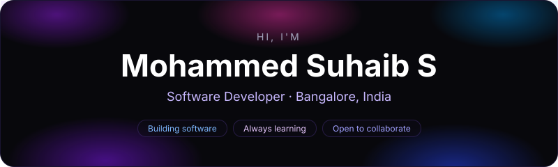

## About Me

I'm **Mohammed Suhaib S**, a software developer based in **Bangalore, India**. I enjoy turning ideas into clean, reliable software and picking up new tools along the way.

* Currently turning curious ideas into working software
* Always exploring new technologies and better ways to build things
* Open to collaborations, ideas and good conversations

## Let's Connect

 

